# Students DWBI — Student Data Warehouse & Business Intelligence

A simple end-to-end Data Warehouse and Business Intelligence project for student and academic data.

The project extracts operational data from **Microsoft SQL Server**, stores raw copies in **PostgreSQL Staging**, transforms and loads analytical data into **ClickHouse**, orchestrates the workflows with **Apache Airflow**, and presents management dashboards in **Grafana**.

---

## Table of Contents

- [Architecture](#architecture)
- [Technology Stack](#technology-stack)
- [Data Sources](#data-sources)
- [Data Warehouse Model](#data-warehouse-model)
- [ETL and Airflow Workflows](#etl-and-airflow-workflows)
- [Dashboards](#dashboards)
- [Repository Image Guide](#repository-image-guide)
- [Execution Flow](#execution-flow)

## Architecture

```text
Microsoft SQL Server
Operational Database: Students
          |
          | Extract
          v
Apache Airflow + Python / PySpark
          |
          v
PostgreSQL
Staging Database: staging
          |
          | Transform / Load
          v
ClickHouse
Data Warehouse: StudentsDW
          |
          v
Grafana
Management Dashboards / DWBI
```

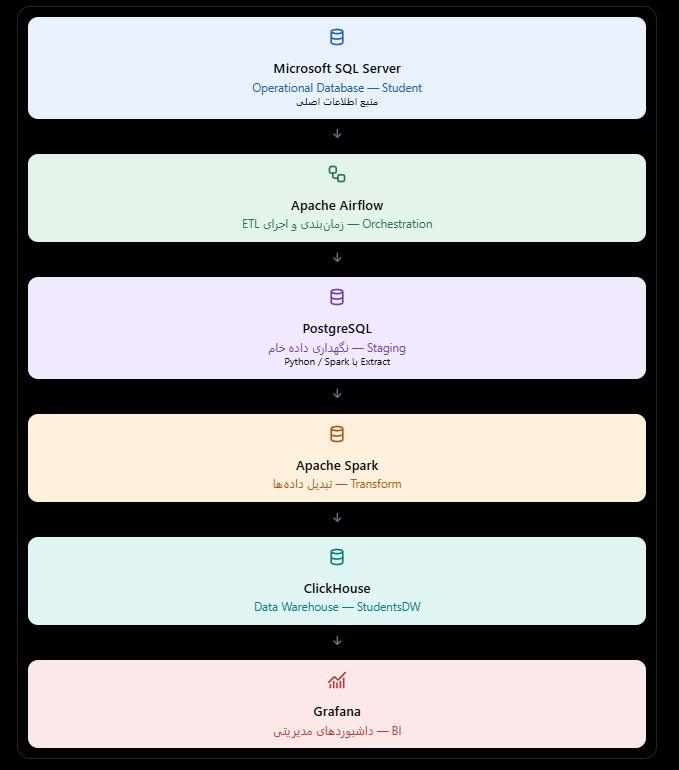

### Architecture overview

| Layer | Technology | Responsibility |
|---|---|---|
| Operational source (OP) | Microsoft SQL Server | Holds the original student and academic application data |
| Orchestration | Apache Airflow | Schedules, coordinates, and monitors ETL workflows |
| Extraction and transformation | Python / PySpark | Reads source data, transfers it, and performs transformations |
| Staging | PostgreSQL | Keeps extracted raw/source-aligned data before warehouse loading |
| Data Warehouse | ClickHouse | Stores analytical dimensions and fact tables |
| BI / Visualization | Grafana | Displays management and analytical dashboards |

The implementation uses **Spark in local mode** in the Airflow environment. This keeps the deployment straightforward and avoids requiring a separate Spark cluster for this project.

## Technology Stack

- Microsoft SQL Server — operational database
- PostgreSQL — staging database
- ClickHouse — analytical data warehouse
- Apache Airflow — workflow orchestration
- Python — ETL and workflow scripts
- Apache Spark / PySpark — data extraction and transformation
- Grafana — dashboards and reporting
- Docker — service deployment (where configured)

## Data Sources

The operational database is named `Students` and its tables are under the `dbo` schema.

The source objects visible in the SQL Server environment include:

- `Applicants`
- `ClassStandings`
- `CourseEnrollments`
- `CourseOfferings`
- `Courses`
- `DegreeLevels`
- `DegreeRequirements`
- `DegreeTypes`
- `Degrees`
- `Departments`
- `Grades`
- `Sessions`
- `StudentProfiles`
- `Students`
- `Terms`

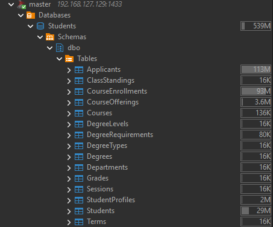

## Staging Database

The PostgreSQL database is named `staging`. Extracted source data is stored in the `staging` schema using raw tables.

Examples visible in the staging database:

- `raw_applicants`
- `raw_classstandings`
- `raw_courseenrollments`
- `raw_courseofferings`
- `raw_courses`
- `raw_degreelevels`
- `raw_degreerequirements`
- `raw_degrees`
- `raw_degreetypes`
- `raw_departments`
- `raw_grades`
- `raw_sessions`
- `raw_students`
- `raw_terms`

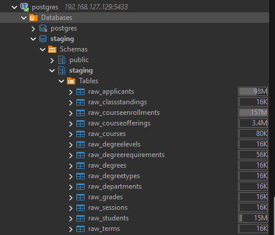

## Data Warehouse Model

The ClickHouse warehouse contains dimension and fact tables. The model follows a dimensional / star-schema approach so that facts can be analyzed through shared dimensions.

### Dimension tables

- `DimApplicant`
- `DimClassStanding`
- `DimCourse`
- `DimDate`
- `DimDegree`
- `DimDepartment`
- `DimGrade`
- `DimStudent`
- `DimTerm`

### Fact tables

- `FactApplication`
- `FactCourseOffering`
- `FactEnrollment`


The following screenshots show the ClickHouse database and its tables:

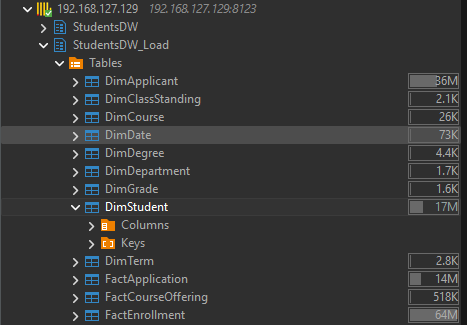

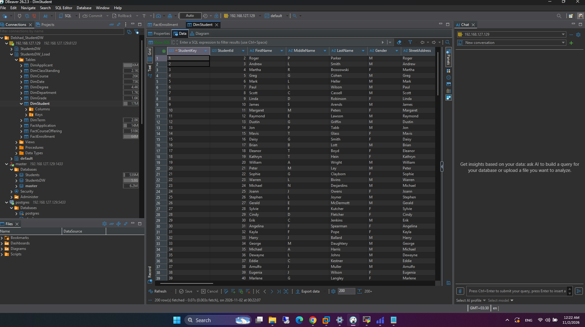

Example data view:

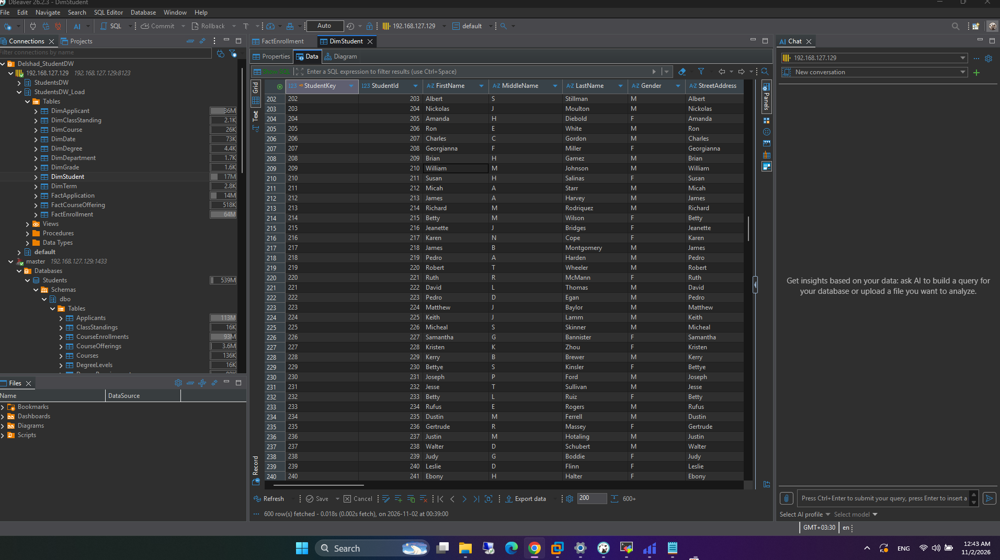

## ETL and Airflow Workflows

Apache Airflow manages the data pipelines. The project contains three DAGs with separate responsibilities.

### 1. `students_dwbi_pipeline` — initial / full-load pipeline

This workflow transfers the operational data from SQL Server to PostgreSQL staging and then transforms and loads it into ClickHouse.

Tasks shown in the DAG:

1. `extract_mssql_to_staging`
2. `transform_staging_to_dw`

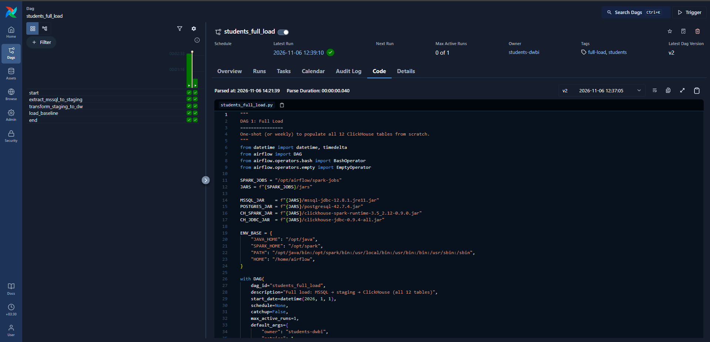

### 2. `students_dims_scd` — dimension refresh with SCD Type 2

This workflow handles dimension extraction and SCD Type 2 processing. The visible task sequence includes:

1. `extract_dims_cdc`
2. `scd2_dimensions`
3. `refresh_dim_date`
4. `validate_dims`

The purpose of SCD Type 2 is to preserve dimension history by keeping historical versions of dimension records rather than simply overwriting every change.

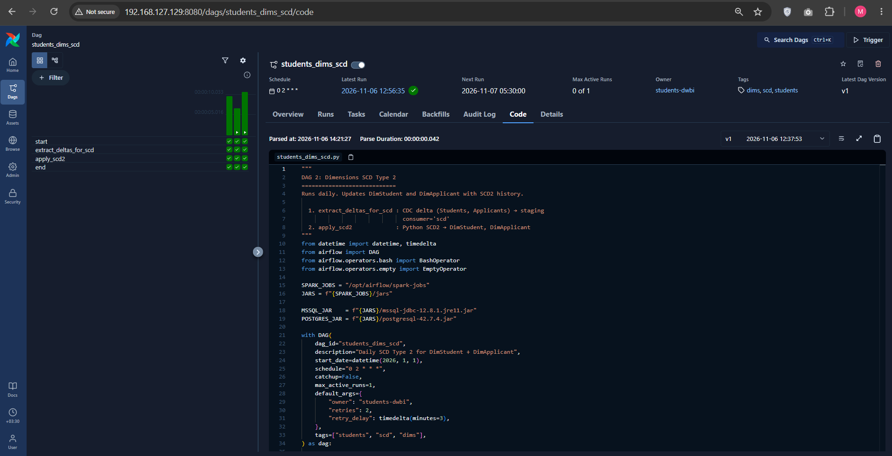

### 3. `students_facts_cdc` — fact incremental loading

This workflow handles incremental extraction and upsert of fact data. Its visible tasks are:

1. `extract_facts_cdc`
2. `facts_upsert`

The DAG is configured in the shown Airflow environment to run every 15 minutes.

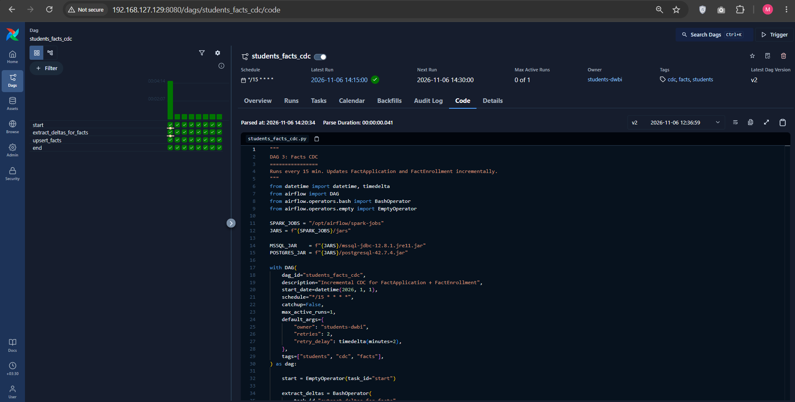

### Airflow DAG overview

The Airflow environment shows these three DAGs:

- `students_dwbi_pipeline`
- `students_dims_scd`
- `students_facts_cdc`

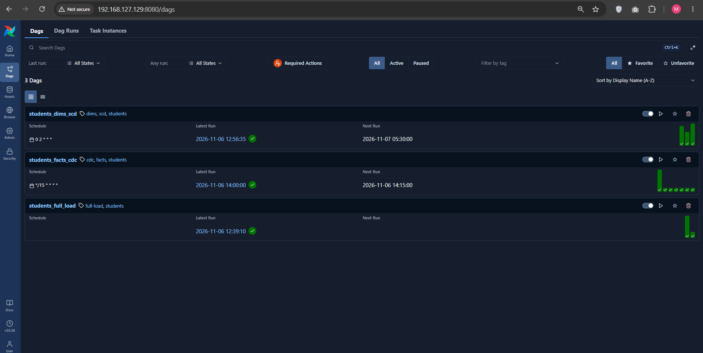

## Dashboards

Grafana is used as the BI presentation layer. The dashboards provide a consolidated view of student, application, enrollment, course, department, and academic performance metrics.

The supplied dashboard examples include:

- Applicant and application indicators
- Active student and enrollment indicators
- Course and department metrics
- GPA and SAT score visualizations
- Application and enrollment distributions
- Grade and course summaries

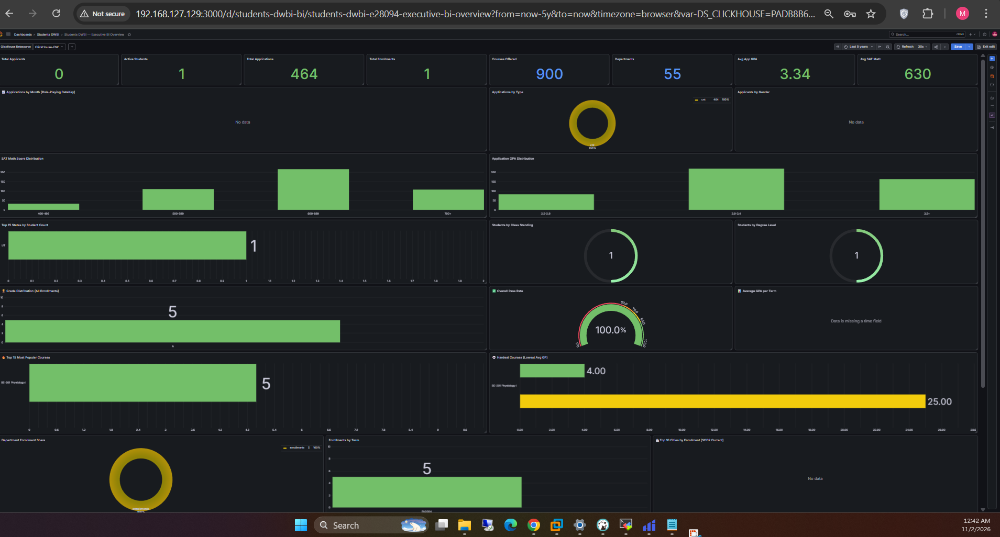

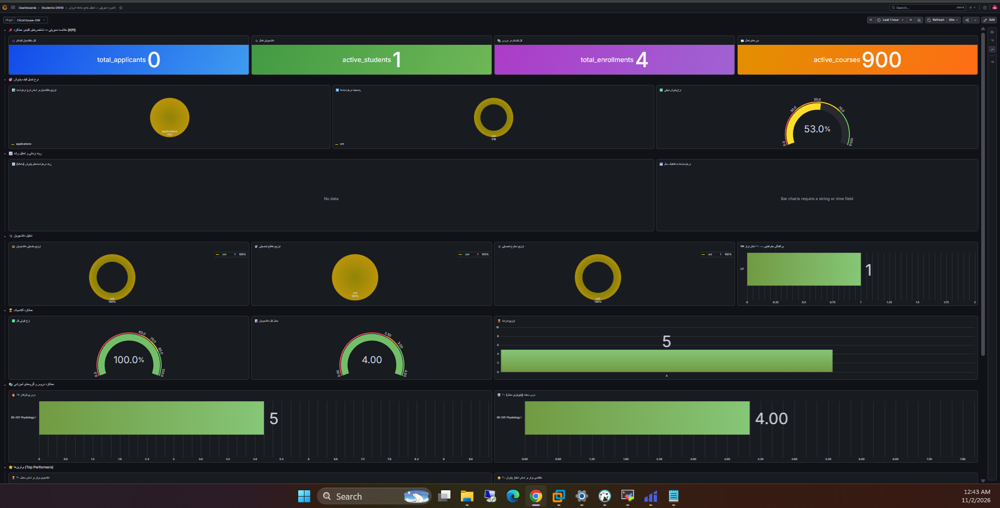

Dashboard panels depend on the availability and quality of the underlying warehouse data. A panel displaying `No data` or a missing time-field message indicates that its query or time-series configuration may need further adjustment.

## Repository Image Guide

All screenshots used in this README are stored under `docs/images/`.

| File | Description |
|---|---|
| `OP_DB.png` | SQL Server operational database |
| `Staging_DB.png` | PostgreSQL staging database |
| `DW_DB.png`, `DW_DB_2.png` | ClickHouse warehouse tables |
| `DW_SAMPLE.png` | Example warehouse data |
| `warehouse-schema.png` | Warehouse schema / relationship diagram |
| `ETL_ARCH.png`, `ETL_ARCH_DETAIL.png`, `ETL_CONCEPT.png` | ETL architecture illustrations |
| `base_full_load.png` | Initial/full-load Airflow workflow |
| `scd.png` | Dimension SCD workflow |
| `cdc.png` | Fact CDC workflow |
| `dags.png` | Airflow DAG overview |
| `BI.png`, `BI2.png` | Grafana dashboard screenshots |

## Execution Flow

The end-to-end processing sequence is:

1. Read operational records from SQL Server (`Students`).
2. Extract the source data with Python / PySpark.
3. Store the extracted records in PostgreSQL (`staging`).
4. Transform the staged data and load the dimensional model into ClickHouse (`StudentsDW`).
5. Run dimension and fact incremental workflows through their Airflow DAGs.
6. Explore the warehouse data through Grafana dashboards.

---

## Project Notes

- Database names, table names, and DAG identifiers in this document follow the supplied environment screenshots.
- The README documents the visible architecture and workflow structure; connection credentials, passwords, host-specific configuration, and deployment secrets are intentionally not included.
- Before publishing the repository, keep credentials in environment variables or Airflow Connections rather than committing them to source control.
